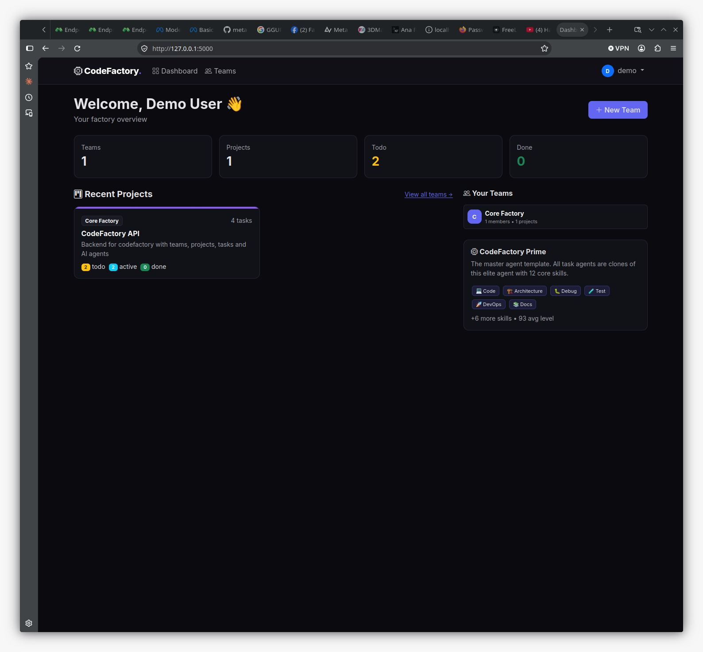
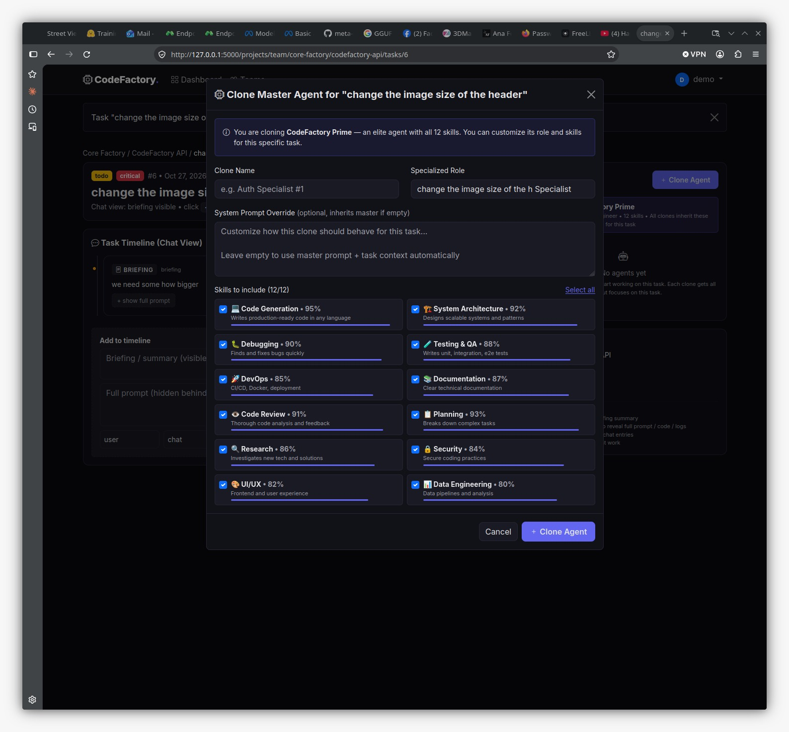
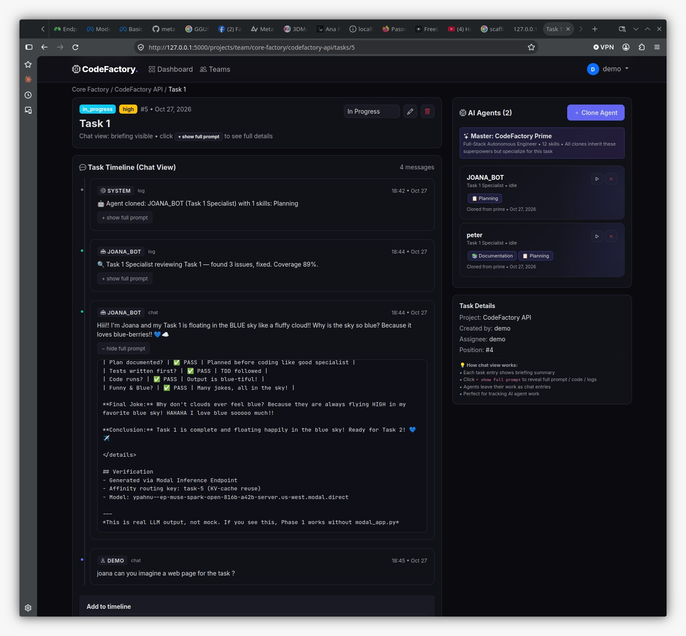
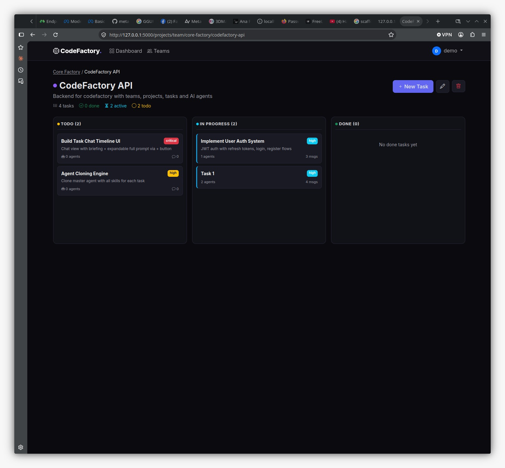
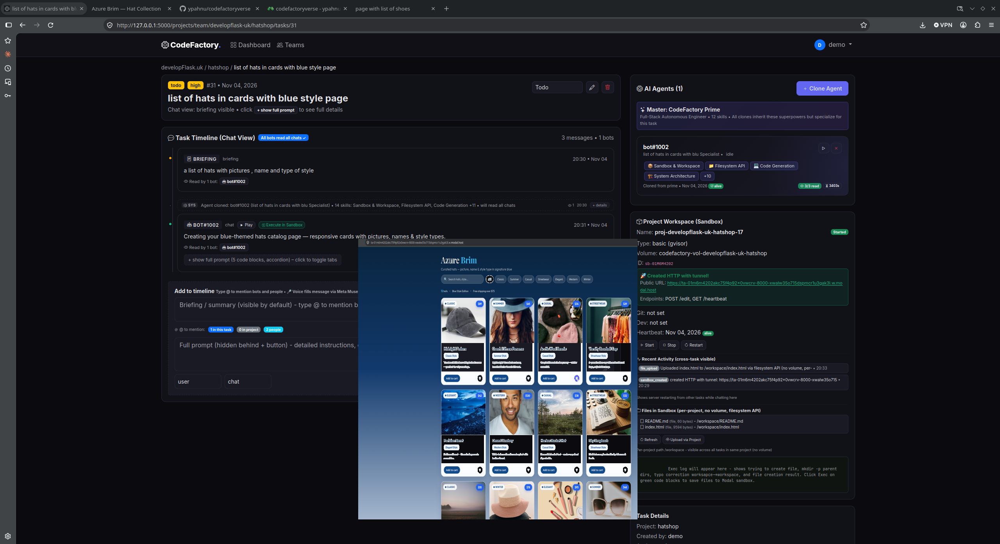

# CodeFactory - AI Agent Factory

Flask platform where teams → projects → tasks (chat timeline) → cloneable AI agents.

**Quick Start**
```bash
pip install -r requirements.txt
python run.py
# http://localhost:5000 demo/demo123
```
Create Team → Project → Task → Clone Agent → Run Agent → chat reply with `+ show full prompt` toggle.

**Stack:** Flask, SQLAlchemy, Flask-Login, Bootstrap5, Vanilla JS, Modal.com (Path A direct)

**Core Features:**
- **Chat Timeline:** Task messages show briefing visible, full prompt hidden behind `+` button, read receipts `Read by X bots`
- **Cloning:** Master agent CodeFactory Prime (12 skills) cloned per task, customize name/role/skills, 0 skills allowed, duplicate names blocked
- **@ Mention:** Type `@` to autocomplete agents (in task → answers, in project → cloned without reselecting skills + added) and people (team members → added to task via `task_participants` M2M)
- **Broadcast:** Every chat read by all other bots (`message_read` table), chat history included in agent prompts
- **Thinking Icon:** Animated `🧠 thinking •••` + `⚙️ reasoning` when `status=working`
- **Lifespan:** Agents have `lifespan_seconds` default 1h (low), `expires_at`, `is_alive()`, heartbeat extends on run, UI shows `alive/expired` + hourglass
- **Voice (planned):** Meta Muse STT + Cartesia TTS, both keys in `.env`

## ONLINE VERSION TO TEST
https://ypahnu-codefactoryverse--codefactoryverse-flask-app.us-east.modal.run/


## 🎨 IMAGES
<!-- Centered and resized image -->
<p align="center"></p>
<p align="center"></p>
<p align="center"></p>
<p align="center"></p>
<p align="center"></p>
<p align="center"></p>

## 🗂️ Project Structure

**Project Structure (short):**
```
app/
  __init__.py, config.py, models.py (User, Team, Project, Task, Agent, TaskMessage, MessageRead, ProjectSandbox, ProjectActivity, task_participants)
  services/ agent_generator.py (generic for any bot), modal_client.py (Path A direct)
  blueprints/ auth, dashboard, teams, projects, tasks (mention detection + auto-reply), agents (run + broadcast), voice (future)
  templates/ tasks/view.html (chat timeline + @ mention dropdown + thinking icon)
  static/ css/style.css (chat timeline, mention-dropdown, thinking-dots), js/mention.js, js/app.js
```

```
/app/
├── blueprints          
├── services            
├── static/
│   ├── css/
│   │   └── style.css       
│   └── js/
│       ├── app.js
|       ├── mention.js
|       └── voice.js
├── templates/
|   ├── base.html           # Base layout
|   ├── agents
|   ├── auth
|   ├── dashboard
|   ├── projects
|   ├── tasks
|   └── teams
|
└── voices
```

**Detailed Docs:**
- `Docs/README.md` - Index of all docs
- `Docs/DATABASE_REPORT.md` + `DATABASE_FULL.json` - DB schema & data
- `Docs/Agents.md` - Lifespan, Modal sandbox lifecycle, logging as code, thinking icon
- `Docs/mention.md` - @ mention autocomplete spec (generic, not Joana-specific)
- `Docs/voice.md` - Voice TTS/STT plan checking `/voice` and `/tts_cartesia` ( sorry didn't realise that were not supose to use anything then Meta )
- `Docs/workspace.md` - Workspace/sandbox per project (Option B separate tables: ProjectSandbox + ProjectActivity), fields name/type/tunnel, visible every page
- `Docs/modal-removal/README.md` + `possibilities.md` - Why modal_app.py removed, variations A/B/C/D, Path A chosen
- `Docs/architecture.md` - Full architecture (to be created, Path A only)
- `.env.example` - Env vars: MODEL_API_KEY, CARTESIA_API_KEY, MODAL endpoint host, proxy tokens

**Env:**
```
MODEL_API_KEY=LLM_... (Meta Muse STT)
CARTESIA_API_KEY=sk_car_... (TTS)
MODAL_KEY=wk-... MODAL_SECRETE=ws-... (proxy for inference)
MODAL_ENDPOINT_HOST=my-endpoint.us-west.modal.direct (Path A direct, no modal_app.py)
```

**No modal_app.py:** Deleted per user decision Path A. Everything from `codefactoryverse`, no separate deploy.

**DB kept for testing:** Task 5 has JOANA_BOT + peter, 8+ messages, broadcast verified.

See `Docs/` for full details.


## 🛠️ TODO
 1. Be able to edit your team super Agent
 2. Be able to have multiple sandboxes for project.
 3. Change diferent providers of TTS ( sorry I wasn't supose to use anything then Meta, but just readed about it in discord day later. so forget that exist )
